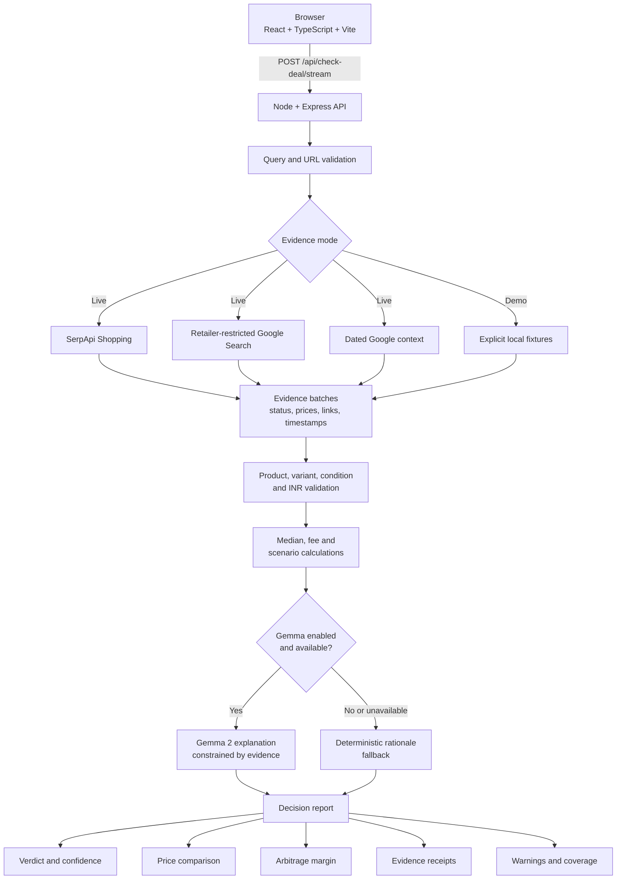

# HustleRadar

HustleRadar is a human-in-the-loop AI decision workspace for people who buy expensive inventory with their own money.

It answers a practical question:

> Is this advertised deal actually worth buying if I need a realistic resale margin?

The application compares like-for-like product listings, validates the evidence, calculates a fee-adjusted resale outcome and asks Google Gemma 2 to explain the result. The model is used for bounded synthesis; the source evidence and important arithmetic remain deterministic and inspectable. The person remains responsible for the final purchase decision.

[](https://www.typescriptlang.org/)
[](https://react.dev/)
[](https://vitejs.dev/)
[](https://expressjs.com/)
[](https://ai.google.dev/gemma)
[](https://serpapi.com/)
[](LICENSE)

## Links

- Architecture notes: [HUSTLERADAR_ARCHITECTURE.md](HUSTLERADAR_ARCHITECTURE.md)

## OmniRush Buildathon track: Human × AI

HustleRadar is prepared for the **Human × AI** track. It is an AI-assisted professional workflow for people making real purchasing, procurement and resale decisions.

The product deliberately keeps the human in control:

1. The buyer chooses the product, offer price and comparison intent.
2. SerpApi gathers market evidence from multiple sources.
3. Deterministic validation rejects mismatched products and unusable prices.
4. The decision engine calculates the market and fee-adjusted outcome.
5. Gemma 2 explains the retained evidence in plain language.
6. The buyer reviews sources, warnings, calculations and uncertainty before deciding.

This is not an autonomous purchasing agent. It is a transparent decision assistant that reduces research effort while preserving human judgment and accountability.

## The problem

A crossed-out price is a marketing claim, not proof of a profitable purchase. A reseller still needs to know:

- whether the reference price is meaningful;
- what other stores charge for the exact configuration;
- whether the listing is the right model, generation, condition and variant;
- what price could realistically be recovered at resale;
- what remains after marketplace fees, delivery, coupons and other costs; and
- whether the evidence is strong enough to make a cash-sensitive decision.

HustleRadar turns those questions into a repeatable professional workflow instead of a generic shopping chat. It is designed for electronics flippers, retail arbitrage beginners, freelance studios, photographers, video editors, procurement teams and small e-commerce operators.

## What the application does

1. Accepts a product name or supported product URL, an optional offer price and an optional reference price.
2. Resolves and validates the product identity before comparing listings.
3. Collects live evidence through three independent SerpApi paths or loads explicitly labelled demo fixtures.
4. Filters accessories, wrong generations, refurbished items, unavailable listings, mismatched configurations and unusable prices.
5. Calculates the market floor, market median, source coverage and fee-adjusted resale margin.
6. Streams evidence progress to the browser through NDJSON.
7. Sends the retained facts to Gemma 2 for a short explanation when an LLM is enabled.
8. Falls back to a deterministic rationale when the model is disabled or unavailable.

## Core capabilities

### Evidence-first market comparison

The server collects Shopping offers, retailer-restricted search results and dated context separately. Each source record retains its title, canonical link, retailer, price, availability, timestamp and provenance. Provider errors remain visible instead of being converted into successful empty results.

### Product and variant protection

The validation layer prevents a cheap but unrelated listing from becoming the lowest comparable price. It checks model identity, generation, product family, storage, RAM, screen size, colour, condition, accessory language, currency, availability and plausible price ranges.

### Deterministic arbitrage calculations

The decision engine calculates the numbers before language generation. The current simplified resale model is:

```text
estimated net profit = expected resale price × (1 − marketplace fee) − sourcing price
```

The application exposes the sourcing price, market floor, market median, estimated fee, projected net profit, margin percentage and warnings. Scenario tools can model delivery fees, coupons and bank discounts rather than hiding them inside an optimistic headline percentage.

### Bounded Gemma 2 explanation

Gemma 2 receives structured facts such as the normalized product, verdict, confidence, claimed price, market median, lowest comparable listing and calculated arbitrage result. It is instructed not to invent prices or retailers. If the model is disabled or unavailable, the deterministic evidence-backed rationale remains available.

The model supports the operator rather than replacing the operator. The UI keeps retailer sources, calculations and warnings visible so a person can challenge the recommendation, refine the product match or stop the purchase.

### Explicit live and demo modes

Live mode calls configured providers and reports the status it receives. Demo mode loads labelled local fixtures for reproducible previews and offline tests. A failed live provider never silently becomes demo evidence.

## Architecture



### Evidence pipeline

The live evidence service starts the three provider paths concurrently with `Promise.all`. Each path returns a typed batch with `success`, `empty` or `error` status, excluded-row counts and warnings. Retailer search also returns per-store coverage.

SerpApi requests are server-side and use:

- `google_shopping` for structured offers;
- retailer-specific Google searches using `as_sitesearch`;
- a dated Google search using `tbs: "qdr:y"` for recent context;
- `gl=in` and `hl=en` for the Indian market and English-language results;
- bounded timeouts and request cancellation through `AbortSignal`.

Shopping and retailer rows are rejected when they contain foreign currency, EMI or monthly prices, MRP, ranges, ambiguous promotional text, invalid URLs or no usable INR purchase price. Retailer candidates are canonicalized, deduplicated and verified against the retailer page where possible before entering the comparison.

### Decision pipeline

The verdict engine works on retained evidence, not raw model output. It can return:

- `genuine_deal` when the offer is competitive against comparable listings;
- `inflated_discount` when the displayed reference price exaggerates the current market discount;
- `not_actually_cheap` when the offer is materially above the market;
- `market_overview` when no offer price was supplied; or
- `insufficient_data` when there is not enough trustworthy evidence.

Confidence reflects evidence volume and coverage. It is not an invented model score.

## API surface

| Method | Endpoint | Purpose |
| --- | --- | --- |
| `GET` | `/api/health` | Returns service, provider configuration, analysis version and timestamp. |
| `POST` | `/api/resolve-product` | Resolves a product name or supported product URL into a normalized query. |
| `POST` | `/api/check-deal` | Returns one JSON decision report. |
| `POST` | `/api/check-deal/stream` | Returns NDJSON progress events followed by a result event. |

The streaming endpoint sends progress for identity, Shopping, retailer, context and analysis stages. If the browser disconnects, the server aborts provider work where supported.

## Repository layout

```text
apps/server/src/
  routes/              Express request handlers
  services/            SerpApi, retailer, validation, verdict and LLM logic
  db/                  Evidence cache and observation storage
  types.ts             Shared server-side domain types
apps/server/test/      Offline Node test suite
apps/web/src/
  pages/               Landing page and investigator flow
  components/          Reports, evidence panels, charts and UI effects
  lib/                 API client, types and browser utilities
vercel.json            Vercel frontend and serverless API configuration
.env.example           Redacted local configuration template
package.json           Workspace scripts
package-lock.json      Root dependency lockfile
```

## Requirements

- Node.js 20.11.1, pinned by `.nvmrc` and the Docker image.
- npm 10 or newer.
- A SerpApi account and API key for live market scans.
- Ollama with `gemma2:9b` or another configured Gemma-compatible endpoint for local model explanations. LLM access is optional; deterministic rationale works without it.

The repository includes lockfiles. Use `npm ci` for reproducible installation in CI or a clean checkout. Do not commit `.env` files or provider credentials.

## Local setup

### Clone and install

```bash
git clone https://github.com/DeepSaha25/omnirush-Buildathon.git hustleradar
cd hustleradar
npm ci
```

### Configure the environment

Copy the redacted template and edit only the values needed for your environment:

```bash
cp .env.example .env
```

For live mode, set:

```env
SERPAPI_KEY=your_serpapi_key_here
```

For local Gemma through Ollama, install Ollama separately, pull the model and keep the server running:

```bash
ollama run gemma2:9b
```

Then use:

```env
ENABLE_LLM=true
OLLAMA_BASE_URL=http://127.0.0.1:11434
GEMMA_MODEL_NAME=gemma2:9b
```

To exercise the deterministic path without contacting a model provider:

```env
ENABLE_LLM=false
```

Useful server settings include `PORT`, `CORS_ORIGIN` and `SERPAPI_TIMEOUT_MS`. The complete list is in `.env.example`.

### Start development servers

```bash
npm run dev
```

The development processes listen on:

- Frontend: `http://localhost:5173`
- API: `http://localhost:8080`

The frontend uses `/api` by default. Set `VITE_API_URL` when the frontend and API run on different origins.

### Build production assets

```bash
npm run build
```

The frontend is written to `apps/web/dist` and the API is compiled to `apps/server/dist`.

## Testing

Run the single project test command:

```bash
make test
```

The equivalent npm command is `npm test`.

The command builds the server and runs the offline Node test suite. It covers:

- product identity and variant matching;
- accessory, refurbished and wrong-generation rejection;
- INR parsing and price ambiguity rules;
- retailer URL validation and canonicalization;
- Shopping and retailer provider behavior;
- partial provider failures and honest empty evidence;
- explicit live/demo separation;
- deterministic verdict states and fee calculations;
- disabled-Gemma fallback behavior;
- streamed NDJSON progress and result events; and
- product URL resolution boundaries.

The test suite does not claim to prove a live provider quota or a remote Gemma generation. Provider calls are mocked or disabled so the checks remain offline and repeatable.

## Container build

The multi-stage `Dockerfile` installs the locked workspace dependencies, builds both applications and runs the compiled API. The API also serves the built frontend when the frontend distribution is present in the image.

```bash
docker build -t hustleradar .
docker run --rm -p 8080:8080 \
  --env-file .env \
  hustleradar
```

Open `http://localhost:8080` after the container starts. Live searches require `SERPAPI_KEY`; Gemma is optional and can be disabled with `ENABLE_LLM=false`.

## Vercel deployment

The repository contains a root `vercel.json` for direct deployment as one Vercel project:

- Vite builds the frontend into `apps/web/dist`.
- `api/index.js` exposes the Express API as a Vercel Function.
- `apps/server/dist` is included in the function bundle after the build.
- `/api/*` requests are routed to the serverless API.
- All other routes fall back to the Vite SPA entrypoint.

Deploy from the repository root:

```bash
npx vercel
npx vercel --prod
```

Configure these Vercel project environment variables before production use:

```env
SERPAPI_KEY=your_serpapi_key_here
ENABLE_LLM=true
GEMMA_API_KEY=your_gemma_api_key_here
GEMMA_MODEL_NAME=gemma2:9b
```

For a deterministic deployment without model calls, set `ENABLE_LLM=false`. Local Ollama at `127.0.0.1` is not reachable from a Vercel Function; use a supported remote Gemma-compatible endpoint or the deterministic fallback in production.

After deployment, verify:

```text
https://<your-vercel-domain>/api/health
```

The health endpoint returns service status, provider configuration state, analysis version and timestamp without exposing credentials.

## Reproducibility and operational boundaries

- Live and demo evidence are separate modes. Live provider failures never silently load fixtures.
- Evidence is cached by mode and normalized query, not by a final verdict or user claim price.
- A new offer price recomputes the decision over retained evidence.
- Provider errors are sanitized before reaching the browser.
- Seller links are validated before they are rendered as clickable sources.
- Request bodies and product query lengths are bounded.
- CORS is configurable through environment variables.
- Optional LLM credentials do not participate in correctness; the deterministic fallback remains available.
- `.data/` observations and local environment files are ignored and should not be committed.

## Why these integrations matter

### Human decision support

The product supports a concrete cash-sensitive decision: whether to buy an item for realistic resale or procurement. It combines market research, product matching and fee arithmetic into one repeatable workflow while leaving the final decision with the operator.

### Gemma 2

Gemma 2 is used as a constrained deal auditor and resale advisor. It receives structured, validated facts after the deterministic calculations are complete. It does not discover prices or invent retailers, and the application remains useful when the model is disabled.

### SerpApi

SerpApi supplies the live grounding layer through Shopping, retailer-restricted and dated context searches. The adapter validates currency, URLs, listing identity, availability and source status before evidence reaches the decision engine.

### Vercel

Vercel serves the Vite frontend and the Express API through the root `vercel.json` configuration. The frontend is deployed as static assets, while `api/index.js` adapts the compiled Express application to a Vercel Function.

## Security and privacy

SerpApi and LLM credentials are read from environment variables and are not stored in source files. SerpApi requests are made by the server so provider keys are not exposed to the browser. The API limits JSON request bodies, validates URLs before rendering them and sanitizes provider failures. Do not paste secrets into issue reports, screenshots or committed files.

## License

This project is released under the [MIT License](LICENSE).
